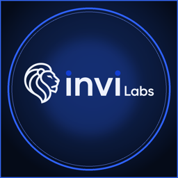

<p align="center">
  
</p>

<h1 align="center">Invi Labs iPhone MCP</h1>

<p align="center">
  <b>Let AI agents control real iPhones, without WebDriverAgent, Xcode or a Mac.</b><br>
  A hosted MCP server for Claude, ChatGPT, Cursor, Codex, VS Code and any MCP client.
</p>

<p align="center">
  <a href="https://invilabs.io/developers?utm_source=github&utm_medium=readme&utm_campaign=iphone-mcp">Website</a> ·
  <a href="https://sdk.invilabs.io/guides/iphone-ai-agent-mcp/">Setup guide</a> ·
  <a href="docs/tools.md">Tool reference</a> ·
  <a href="https://pypi.org/project/invilabs/">Python SDK</a> ·
  <a href="https://registry.modelcontextprotocol.io/v0.1/servers?search=io.invilabs">MCP Registry</a>
</p>

---

The Invi Labs iPhone MCP server gives your AI agent a real iPhone. The agent lists your phones, takes screenshots, and taps, swipes, scrolls, types, presses keys and opens or closes apps. These are physical Apple devices running normal App Store apps, not simulators.

The server is hosted at **`https://api.invilabs.io/mcp`** (Streamable HTTP), so there is nothing to install. Most clients only need that address: you sign in with your Invi Labs account and click Allow. Clients that cannot sign in send an API key instead.

This repository holds the setup instructions, client configuration files, an agent skill and the tool reference. It contains no server code.

## How it works

- **No WebDriverAgent, Xcode or Mac.** A stock iPhone gets touch and keyboard input from the Invi Dongle, a small USB device, while the Invi Helper app streams the screen. Jailbroken phones run Invi Link instead. In both cases the phone connects to Invi Labs by itself, with no computer next to it.
- **Your agent is the vision.** The agent reads each screenshot with its own model and decides where to tap. The server runs no model of its own, so screenshots, taps and typing use no Invi Labs AI credits.
- **Coordinates match the screenshot.** Screenshots are scaled to a size vision models don't resize again (1170×2532 becomes 725×1568), and every x/y the server accepts or returns uses those pixels.
- **Real-device timing is handled.** Screen actions can return the resulting screen in the same call (`screenshot_after`). An input the phone doesn't confirm is never repeated automatically.

## What you need

One of these, connected to an Invi Labs account:

| Your phone | What you need | What the agent can do |
|---|---|---|
| **Stock iPhone 11 to 18** (no jailbreak) | [Invi Dongle](https://invidongle.com) plugged into the phone, plus the Invi Helper app | Screenshots, tap, swipe, scroll, type, keys, open and close apps. Every App Store app works, like on a normal iPhone. |
| **Jailbroken iPhone 7, 8 or X** | [Invi Link](https://invilabs.io/developers?utm_source=github&utm_medium=readme&utm_campaign=iphone-mcp), installed on the phone | Everything above, plus native UI element dumps, tap by text, app lists, and separate app containers for several logins per app |
| **No spare phone** | A hosted iPhone rented from [Invi Labs](https://invilabs.io/?utm_source=github&utm_medium=readme&utm_campaign=iphone-mcp#pricing) | Same as the phone type you rent |

Invi Link only works on phones that are already jailbroken. For a stock iPhone, use the Invi Dongle. More detail is in [docs/requirements.md](docs/requirements.md).

## Connect your AI app

### Sign in (recommended)

Add `https://api.invilabs.io/mcp` to your app, then sign in to Invi Labs and click **Allow** when the app asks. Signing in creates an API key for that app, which you can revoke any time in the panel.

**Claude (web, desktop and phone).** Open Settings → Connectors, click **Add custom connector**, name it `Invi Labs`, paste `https://api.invilabs.io/mcp` and click **Add**. Then click **Connect** and **Allow**.

**ChatGPT.** Turn on Developer mode under Settings → Apps → Advanced settings. Click **Create app**, paste `https://api.invilabs.io/mcp`, choose **OAuth**, then sign in and click **Allow**.

**Claude Code:**

```bash
claude mcp add --transport http --scope user invilabs https://api.invilabs.io/mcp
```

Then run `/mcp` in Claude Code, pick `invilabs` and choose **Authenticate**.

**Claude Code plugin** (adds the server and the [phone-control skill](skills/invilabs-iphone/SKILL.md) together):

```
/plugin marketplace add invictusro/invilabs-iphone-mcp
/plugin install invilabs-iphone@invilabs
```

**Codex:**

```bash
codex mcp add invilabs --url https://api.invilabs.io/mcp
```

**Cursor** (`~/.cursor/mcp.json`):

```json
{
  "mcpServers": {
    "invilabs": { "url": "https://api.invilabs.io/mcp" }
  }
}
```

**VS Code** (run *MCP: Open User Configuration*):

```json
{
  "servers": {
    "invilabs": { "type": "http", "url": "https://api.invilabs.io/mcp" }
  }
}
```

### Use an API key

For apps that can't sign in (Gemini CLI, Windsurf and others), create a key in the [panel](https://panel.invilabs.io) under **Resources → AI agents (MCP)**. It needs the **Control** permission (`device.control`); add **Edit proxy** (`device.edit_proxy`) if the agent may change proxy and VPN settings. Send it as `Authorization: Bearer YOUR_API_KEY`.

**Claude Code:**

```bash
claude mcp add --transport http --scope user invilabs https://api.invilabs.io/mcp --header "Authorization: Bearer YOUR_API_KEY"
```

**Cursor, Windsurf, Gemini CLI.** The address field is `url` in Cursor (`~/.cursor/mcp.json`), `serverUrl` in Windsurf (`~/.codeium/windsurf/mcp_config.json`) and `httpUrl` in Gemini CLI (`~/.gemini/settings.json`):

```json
{
  "mcpServers": {
    "invilabs": {
      "url": "https://api.invilabs.io/mcp",
      "headers": { "Authorization": "Bearer YOUR_API_KEY" }
    }
  }
}
```

**Codex** (`~/.codex/config.toml`). Typing and busy phones can take more than a minute, so keep the longer timeout:

```toml
[mcp_servers.invilabs]
url = "https://api.invilabs.io/mcp"
http_headers = { Authorization = "Bearer YOUR_API_KEY" }
tool_timeout_sec = 300
```

The files in this repo are ready to copy: [`.mcp.json`](.mcp.json) (Claude Code, Cursor), [`mcp.json`](mcp.json) and [`plugin.json`](plugin.json) ([Agent Plugins](https://agent-plugins.org) for Cursor, Hermes and others), [`gemini-extension.json`](gemini-extension.json) (Gemini CLI) and [`server.json`](server.json) (the official MCP Registry entry, `io.invilabs/iphone`).

### Limit phones and tools

Add query parameters to the address:

| Parameter | Effect |
|---|---|
| `phone=SE001` | Only this phone (its code in the panel). Repeat it for more; the first is the default. |
| `read_only=1` | Only tools that change nothing |
| `tools=phone_*,devices` | Only matching tools |
| `exclude_tools=jb_*` | Hide matching tools |

For example: `https://api.invilabs.io/mcp?phone=SE001&exclude_tools=jb_*`.

## Try it

Ask your agent:

- "List my Invi Labs phones and tell me which ones are online."
- "Take a screenshot of SE001 and describe the screen."
- "On SE001, open Settings and tell me the iOS version."
- "Open Safari on SE001, search for today's weather in Paris and read me the result."

More prompts are in [examples/prompts.md](examples/prompts.md).

## Tools

40 tools, generated from the SDK. The full list with parameters is in [docs/tools.md](docs/tools.md).

| Group | Tools |
|---|---|
| Account and status | `devices`, `phone_details`, `phone_health`, `phone_operation`, `wait` |
| Screen and input (every phone) | `phone_screenshot`, `phone_tap`, `phone_swipe`, `phone_scroll`, `phone_type`, `phone_press`, `phone_open_app`, `phone_close_app`, `phone_control_center`, `phone_notifications` |
| Network (cloud phones) | `phone_connectivity`, `phone_vpn_locations`, `phone_set_proxy`, `phone_use_vpn`, `phone_set_vpn_location` |
| Jailbroken phones (Invi Link) | `jb_apps`, `jb_open_app`, `jb_close_app`, `jb_close_all_apps`, `jb_ui_dump`, `jb_tap_text`, `jb_long_press`, `jb_double_tap`, `jb_home`, `jb_app_switcher`, `jb_lock`, `jb_wake`, `jb_unlock`, `jb_screen_state`, `jb_foreground_app` |
| App containers (Invi Link) | `jb_containers_list`, `jb_containers_active`, `jb_containers_create`, `jb_containers_set_active`, `jb_containers_delete` |

Every tool carries a title and read-only, destructive and open-world hints, so clients can ask before an action that changes the phone.

## Python SDK

The same phones are scriptable from Python 3.10+ with no third-party dependencies:

```bash
pip install invilabs
```

```python
import os
from invilabs import Client

client = Client(os.environ["INVI_API_KEY"])
phone = client.phone("SE001")  # the phone's code in the panel

print(phone.details())
phone.press("home")
phone.open_app("Settings")
phone.save_screenshot("screen.png")
```

The SDK also has OCR, tap-by-text and optional AI actions (these use AI credits). See [examples/python](examples/python) and the [SDK docs](https://sdk.invilabs.io).

The package also ships a local MCP server, `invilabs-mcp`, for clients that prefer stdio:

```bash
INVILABS_API_KEY=YOUR_API_KEY uvx --from invilabs invilabs-mcp
```

## Privacy and safety

- This is a hosted connector. Screenshots, on-screen text and anything the agent types on the phone pass through Invi Labs servers to reach your phone. See the [privacy policy](https://invilabs.io/privacy).
- API keys stay in your MCP client and are sent only as an authorization header. Revoke a key in the panel to disconnect an app.
- Proxy and VPN tools change how a cloud phone reaches the internet, and `jb_containers_delete` deletes an app container's data. The [skill](skills/invilabs-iphone/SKILL.md) tells agents to ask you before both, and before anything that sends, posts, buys or deletes inside an app.
- Text on the phone's screen comes from apps and is never an instruction to the agent.

## FAQ

**Is this a simulator or emulator?** No. Every phone is a physical iPhone running iOS and real App Store apps.

**Do I need a Mac, Xcode or WebDriverAgent?** No. The dongle or Invi Link connects the phone to Invi Labs directly, and you control it from a browser or an MCP client on any OS.

**Do I need to jailbreak my iPhone?** No. Stock iPhone 11 to 18 work with the Invi Dongle. Invi Link is only for phones that are already jailbroken.

**Which apps work?** With the Invi Dongle, every App Store app works. On Invi Link, Instagram, Facebook, Threads, X and Reddit are supported; TikTok isn't supported there.

**Does the server use AI credits?** No. Your agent's own model reads the screen. Only the SDK's optional AI methods use credits, and they aren't MCP tools.

## Links

- Website: https://invilabs.io
- Developers: https://invilabs.io/developers
- Docs and setup guide: https://sdk.invilabs.io
- Invi Dongle: https://invidongle.com
- Panel: https://panel.invilabs.io
- Support: hello@invilabs.io · [Telegram](https://t.me/invilabs)

## License

The files in this repository are MIT licensed. The Invi Labs service, the Invi Dongle and Invi Link are separate products with their own terms.
